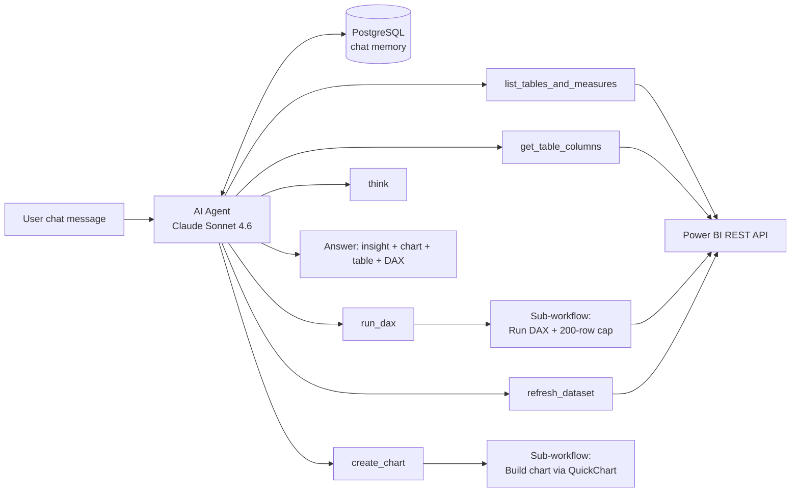

# InsightIQ: Conversational BI Agent for Power BI

> Ask questions about your Power BI data in plain English and get answers, charts and key insights in one reply. No waiting for an analyst to write DAX or build a report.


---

## The problem

Business teams have questions about their data every day: *"What is our OTIF % by customer?"*, *"Show revenue by city as a bar chart."* Each question usually means asking an analyst, who writes a DAX query or builds a report, and the answer comes back hours or days later.

## The solution

Talk2BI is an AI agent built in [n8n](https://n8n.io). A user types a question in a chat window. The agent:

1. Looks up the real tables, columns and measures in the Power BI semantic model
2. Writes and runs the DAX query through the Power BI REST API
3. Replies with a headline insight, a chart, a data table, the exact DAX used, and a few observations

It reuses the measures your data team already defined (for example `[Total Sales]`), so its numbers match your official reports.

---

## Key features

| Feature | What it does |
|---|---|
| **Plain-English questions** | Users chat in natural language; the agent turns questions into DAX |
| **Schema discovery** | Reads tables, measures and columns first, so it never invents field names |
| **Measure-aware** | Prefers existing measures over hand-written calculations, keeping KPIs consistent |
| **Automatic charts** | Bar, line, pie and doughnut charts generated through QuickChart |
| **Safe query results** | Results are capped at 200 rows with a `truncated` flag so large outputs don't flood the model |
| **Error recovery** | On a failed query, the agent diagnoses the problem and retries once, then asks the user |
| **Follow-up questions** | Conversation history is stored in PostgreSQL (last 10 messages) |
| **Controlled refresh** | The dataset refresh tool runs only when the user explicitly asks |

---

## How it works



### The 6 agent tools

| Tool | Purpose |
|---|---|
| `list_tables_and_measures` | Lists every table and measure in the model |
| `get_table_columns` | Returns column names and data types for one table |
| `run_dax` | Executes a DAX query (via sub-workflow) and returns up to 200 rows |
| `create_chart` | Builds a Chart.js spec and returns a PNG link (via sub-workflow) |
| `refresh_dataset` | Triggers a dataset refresh, only on explicit request |
| `think` | Scratchpad for planning and diagnosing errors before retrying |

### Response format

Every reply follows the same structure: bold headline with the key number, chart, markdown data table, the DAX that was run, and 2-4 observations.

---

## Tech stack

- **Automation / agent framework:** n8n (LangChain Tools Agent)
- **LLM:** Claude Sonnet 4.6 via OpenRouter
- **Query language:** DAX
- **Data source:** Power BI semantic model via the REST `executeQueries` API
- **Memory:** PostgreSQL (`n8n_chat_histories` table)
- **Charts:** QuickChart.io (Chart.js)
- **Authentication:** Microsoft Azure AD service principal (OAuth2 client credentials)

---

## Project structure

```
.
├── docs/
│   ├── ARCHITECTURE.md      # How the agent, tools and auth work
│   ├── AZURE_AD_SETUP.md    # Service principal + Power BI tenant setup
│   └── SECURITY.md          # Hardening guide for production use
├── sql/
│   └── 01-setup.sql         # Creates the chat memory table
├── workflows/
│   ├── 01-pbi-main-agent.json          # Main agent workflow
│   ├── 02-pbi-sub-run-dax.json         # Runs DAX, flattens results, caps rows
│   └── 03-pbi-sub-generate-chart.json  # Builds charts via QuickChart
├── LICENSE
└── README.md
```

---

## Getting started

### Prerequisites

- n8n 1.78 or later (self-hosted or cloud)
- A Power BI workspace with a published dataset
- An Azure AD tenant where you can register an app
- An [OpenRouter](https://openrouter.ai/keys) API key
- A PostgreSQL database (Supabase, Neon, Railway or local)

### Setup

1. **Clone the repo**
   ```bash
   git clone https://github.com/<your-username>/<your-repo-name>.git
   cd <your-repo-name>
   ```

2. **Set up Azure AD and Power BI access.** Follow [`docs/AZURE_AD_SETUP.md`](docs/AZURE_AD_SETUP.md) (about 10 minutes). You will end up with a service principal that is a Member of your Power BI workspace.

3. **Create the memory table.** Run [`sql/01-setup.sql`](sql/01-setup.sql) in your PostgreSQL database.

4. **Import the workflows into n8n**, in this order:
   1. `workflows/02-pbi-sub-run-dax.json`
   2. `workflows/03-pbi-sub-generate-chart.json`
   3. `workflows/01-pbi-main-agent.json`

   Then open the `run_dax` and `create_chart` tool nodes in the main agent and re-bind them to the sub-workflows you just imported (workflow IDs differ per n8n instance).

5. **Create n8n credentials**

   | Credential | Used by |
   |---|---|
   | Microsoft OAuth2 API (client credentials, scope `https://analysis.windows.net/powerbi/api/.default`) | `list_tables_and_measures`, `get_table_columns`, `refresh_dataset`, and the DAX sub-workflow |
   | OpenRouter API | `OpenRouter Chat Model` |
   | Postgres (writable) | `Postgres Chat Memory` |

6. **Set your workspace and dataset.** In the main agent, open the **Config** node and replace the two placeholders:
   - `group_id`: your Power BI workspace GUID
   - `dataset_id`: your dataset GUID

7. **Activate** all three workflows (sub-workflows first), open the main agent and click **Chat**. Try: *"What tables and measures does this model have?"*

---

## Example questions

> **TODO:** Replace these with questions you actually tested on your dataset.

- "What tables and measures does this model have?"
- "Show me total sales by product category as a bar chart."
- "What is the On-Time In-Full % by customer?"
- "Which city has the highest revenue this quarter?"

---

## Results

> **TODO:** Run your own test and fill in real numbers. Do not publish figures you did not measure.

| Metric | Result |
|---|---|
| Dataset used | **[your dataset]** |
| Questions tested | **[N]** |
| Answers matching Power BI | **[X] of [N]** |
| Average response time | **[Y] seconds** |

**How I tested:** I wrote [N] business questions, asked each one in the chat, and checked every answer against the numbers in Power BI.

### Screenshots

> **TODO:** Add 2-3 screenshots (chat reply with chart, n8n workflow canvas).

```md


```

---

## What I did in this project

> **TODO:** Fill this in honestly. It helps recruiters and interviewers see your contribution.

- Deployed and configured the workflows on **[your n8n setup]**
- Connected the agent to **[your Power BI dataset]**
- Customized **[e.g. the system prompt, charts, tools]**
- Tested and fixed **[issues you ran into]**

---

## Limitations

This is a starting template, not a hardened production system.

- The chat URL is public by default; authenticate it before sharing with others.
- Row-level security is not enforced by default, so users can query anything the service principal can read.
- `refresh_dataset` is a write operation; guard it for untrusted users.
- Power BI's REST API allows about 120 requests per minute per service principal.
- It does not send emails or reports. It only answers in the chat.

See [`docs/SECURITY.md`](docs/SECURITY.md) for a layered hardening guide.

---

## Roadmap

- [ ] Multi-dataset support
- [ ] `explain_measure` tool (show a measure's DAX and lineage)
- [ ] Streaming tool-call events to the chat UI
- [ ] Scheduled KPI briefing by email or Teams
